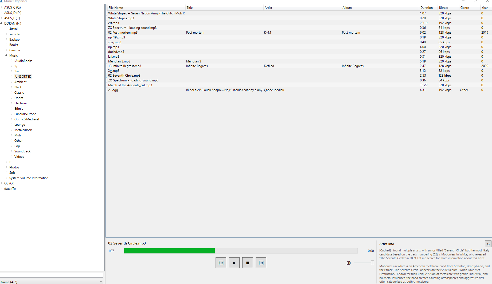
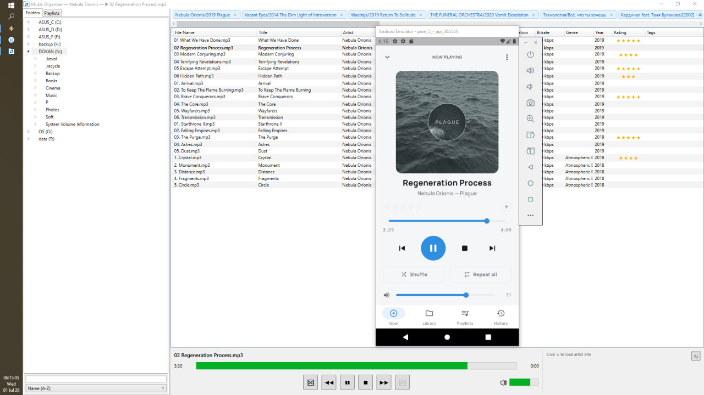

# Music Organiser

A Windows desktop application for managing and playing music files, built with C# WPF and .NET 8.

## Features

### File Browser
- Tree view of all drives (local, network, USB, CD/DVD)
- Async folder loading for responsive UI
- Filter folders by name, with a one-click clear (×) button; a **^** button jumps up to the parent folder
- Filter folders by tag — multi-select dropdown, shows folders matching any selected tag
- Sort folders by Name, Creation Date, or Modified Date (ascending/descending)
- Long sorts run off the UI thread with a busy overlay — the app never freezes on large trees
- Reliable scroll-to-selection when navigating the tree

### Music Library
- Grid view of music files in the selected folder
- Displays metadata: file name, title, artist, album, duration, bitrate, genre, year
- Clear, stable row states: a faint hover wash, an Explorer-blue selection that stays visible when the grid loses focus, and a stronger highlight (plus bold text and a left accent bar) for the currently playing track, which outranks both so it never flickers under the mouse
- Fixed row height, so revealing the inline star/tag editors on hover never nudges the list under your cursor
- Supported formats: MP3, FLAC, WAV, WMA, AAC, OGG, M4A
- Album cover displayed behind the file grid; when a folder has several cover images, the display cycles through them (also on the mobile app's now-playing screen)

### Ratings & Tags
- 1–5 star rating for both tracks and folders
- Free-form comma-separated tags for both tracks and folders
- Filled stars and existing tags show inline; hover a row to reveal the editable stars/tag box
- Ratings and tags are stored in the local cache and survive folder rescans
- **AI tag suggestions** — right-click a folder → *Tag...* to have Claude identify the band from the folder/album names (checking Bandcamp's own genre tags first) and suggest genre tags, reusing the vocabulary already in your library; add/remove suggestions before saving (also available from the mobile app's folder menu)
- **Bulk tag** — right-click a parent folder → *Bulk tag subfolders...* to AI-tag every untagged band folder inside it at once, in reviewable batches of 20, with a per-band preview player to audition tracks while you review (also available from the mobile app)
- **Manage tags** — *Manage tags...* in the folder tree's tag filter popup lists every tag with its folder count and lets you delete a tag or merge it into another, both irreversible and confirmed (also available from the mobile app's tag filter sheet)

### Local Cache (SQLite)
- Files and folders are cached in a local SQLite database (WAL mode) at `%APPDATA%\MusicOrganiser\cache.db`
- First visit reads the filesystem and tags; later visits serve instantly from the cache
- Cache-first display with an in-app background refresh that re-scans and live-updates the grid/tree when files change on disk
- Unchanged files are served from cache without re-parsing tags

### Audio Player
- Play/Pause/Stop controls, Shuffle and Repeat (off/all/one)
- Previous/Next track navigation
- Click-to-seek progress bar
- **Output device selection** — pick any Windows audio device (WASAPI/CoreAudio); the list updates live as Bluetooth/USB devices connect or disconnect
- **In-app volume** and a **Windows system-volume** control (the system bar reflects volume changes made outside the app)
- Auto-play next track when current track ends
- Robust Bluetooth playback: push-mode fallback for endpoints that stall in event mode, and no more hangs when pressing play right after a Bluetooth device connects
- Stereo-to-surround upmix so 2-channel audio plays correctly on 5.1/7.1 devices

### Lyrics & Karaoke Mode
- **Find lyrics on request** — a lyrics panel under the file grid; click *Find* to fetch. Three free, no-key sources are tried in order for synced lyrics — [LRCLIB](https://lrclib.net), then [LRCMux](https://lrcmux.dev) (an aggregator over Genius/KuGou/Musixmatch/NetEase/YouTube Music), then [SyncLRC](https://synclrc.dev) — and if all three miss, an AI web search looks for publicly-available lyrics. If none can be provided, you drop straight into a paste box to add your own. A track any source flags as instrumental stops the search there
- **Karaoke highlight** — the current line highlights (bold + a colored band) and the view auto-scrolls to keep "now" centered; seeking jumps to the right line. A big-letter karaoke view is a click away
- **Time-proportional sync editor** — lyric lines are laid out by their timestamps (big gaps where the song is instrumental), with a moving playhead line. Hand-time any line by tapping *⏺ now* as you hear it (latency-compensated) or nudge ±0.2s; changing one line ripples the rest. Auto-scroll pauses while you're working on a line so it never moves under you. Edits auto-save
- **Whisper sync** — for tracks with only plain lyrics, *Sync* aligns them to the audio using a bundled Whisper.net speech model (no Python); untimed tails are spread across the song, then fine-tune by hand
- Lyrics are stored in the local cache keyed by file path and load instantly on replay; the mobile app shows the same karaoke view and can find/edit/clear lyrics too

### Mobile Remote App
A companion Flutter app (`remote_app/`) controls the desktop over your local network via a built-in HTTP API (port 8787):
- Browse the library (search + sort + tag filter), control playback, edit ratings/tags, manage playlists — all from your phone
- **Karaoke lyrics** — the Now Playing screen shows synced lyrics with the current line highlighted; find, edit, or clear lyrics from the phone (the sync editor and whisper alignment run on the desktop)
- **Stream to phone** — choose "This device" as the output to play the desktop's music on the phone (transcoded AAC, selectable quality) while the desktop stays silent
- **Offline mode** — download tracks, folders or playlists to the phone (mirroring the desktop folder structure) and browse + play them with no connection to the desktop
- **Apple Watch remote** — a control-only watchOS companion (play/pause, next/previous, volume) shipped alongside the iOS app
- No account or cloud — the phone connects directly to the desktop on the LAN (or over VPN)

### AI Artist Info Panel
- AI-powered artist summaries using Claude with web search
- Automatically identifies artists from tags, song titles, and filenames
- Persistent caching of artist info for faster loading
- Refresh button to re-fetch artist information
- Requires Anthropic API key

### File Operations
- Copy/Move/Delete files and folders
- **Waveform seek bar** - the position bar shows the whole track as a loudness chart, so quiet and loud parts are visible; click or drag to seek
- **Folder conflict dialog** - copying or moving a folder to a place that already has the same or a similarly named one opens a FreeFileSync-style comparison: source and target side by side, one action per file or folder (bring in / overwrite, skip, delete from target), Merge and Replace presets, Keep both under a name you can edit, and in-place rename (F2). Unrelated folders in the target are hidden and left alone
- **Drag & drop** — drag tracks (or a whole folder) onto any folder in the tree to move them; hold **Ctrl** to copy. Illegal drops (a folder into itself or its own subtree) are refused, and folder moves ask for confirmation
- **New subfolder** — right-click a folder in the tree to create one
- Recent folders menu (last 10 destinations for Copy and Move separately)
- Confirmation dialog for delete operations
- **Convert to MP3** - right-click one or more tracks → *Convert to MP3* writes a 320 kbps `.mp3` next to each (hi-res sources are resampled to 44.1/48 kHz, tags and cover art are copied, the original is kept, an existing file is never overwritten)
- **Split by .cue** - right-click an album image (one long file) → *Split by .cue...* cuts it into lossless sample-exact `NN - Title.flac` tracks tagged from the cue sheet (the cue is found next to the file, or you pick it); nothing is deleted. Both work on the track that is playing, run in the background with a progress overlay, and are also in the mobile app's track menu
- Automatically stops playback before moving/deleting playing files
- Deleting **or moving** the track you're listening to doesn't stop the music — playback continues with the next track in the queue, whether you used the context menu, the now-playing buttons, drag & drop or the phone

### Quality of Life
- Single-instance app — launching a second copy activates the existing window instead of starting a duplicate
- Picks up where you left off — the folder you were browsing reopens on launch and the track you were playing is re-selected (and scrolled to), so Play resumes it
- Recently-played history stays tidy: deleted folders (and their subfolders) are removed automatically, and a clear button (desktop and mobile) wipes the whole list

## Screenshots



Desktop with the mobile remote app (Now Playing) controlling playback:



## Requirements

- Windows 10 or later
- .NET 8.0 Runtime

## Installation

### Option 1: Build from source
```bash
git clone https://github.com/yourusername/musicorganiser.git
cd musicorganiser
dotnet build -c Release
```

### Option 2: Download release
Download the latest release from the [Releases](https://github.com/yourusername/musicorganiser/releases) page.

## Usage

```bash
dotnet run --project MusicOrganiser
```

Or run the compiled executable directly.

### AI Artist Info Setup (Optional)

The app displays AI-generated artist summaries using Claude Haiku 4.5 with web search. To enable:

1. Get an API key from [Anthropic Console](https://console.anthropic.com/)
2. Create a `.env` file in the project root directory:
   ```
   ANTHROPIC_API_KEY=your-api-key-here
   ```
3. The artist info panel appears on the right side of the player

**How it works:**
- Uses web search to find real-time information about artists
- Identifies artists from ID3 tags, song titles, album names, and filenames
- Caches confident results locally for faster subsequent lookups
- Click the refresh button (↻) to re-fetch artist info

**Note:** Web search costs $10 per 1,000 searches in addition to token costs.

### Keyboard Shortcuts
- **Double-click** on a track to play it
- **Right-click** on folders or files for context menu (Copy/Move/Delete, New subfolder)
- **Drag & drop** tracks or folders onto a folder in the tree to move them (hold **Ctrl** to copy)

## Building

```bash
# Debug build
dotnet build

# Release build
dotnet build -c Release

# Publish as single-file executable
dotnet publish -c Release -r win-x64 --self-contained -p:PublishSingleFile=true
```

## Project Structure

```
MusicOrganiser/
├── Models/           # Data models (MusicFile, FolderRecord, caches, settings)
├── Services/         # Audio player, file operations, metadata, SQLite cache
├── ViewModels/       # MVVM view models
├── Converters/       # WPF value converters
├── Controls/         # Reusable controls (StarRating)
├── MainWindow.xaml   # Main UI
└── App.xaml          # Application entry
```

## Dependencies

- [NAudio](https://github.com/naudio/NAudio) - Audio playback
- [TagLibSharp](https://github.com/mono/taglib-sharp) - Audio metadata reading
- [Microsoft.Data.Sqlite](https://learn.microsoft.com/dotnet/standard/data/sqlite/) - Local SQLite cache for files and folders
- [Anthropic.SDK](https://github.com/tghamm/Anthropic.SDK) - Claude AI integration for artist summaries
- [Whisper.net](https://github.com/sandrohanea/whisper.net) - On-device speech recognition (whisper.cpp) for aligning lyrics to audio
- [DotNetEnv](https://github.com/tonerdo/dotnet-env) - Environment variable loading from .env files

## License

MIT License - see [LICENSE](LICENSE) for details.
